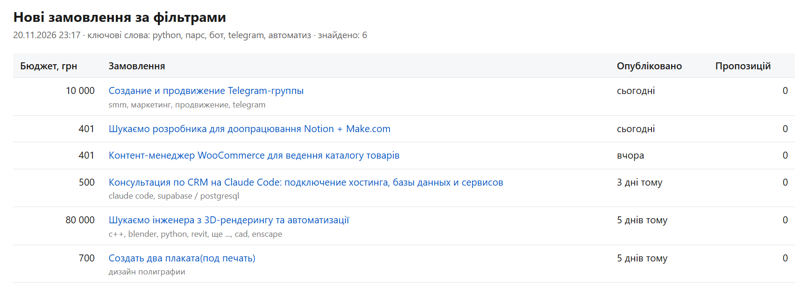
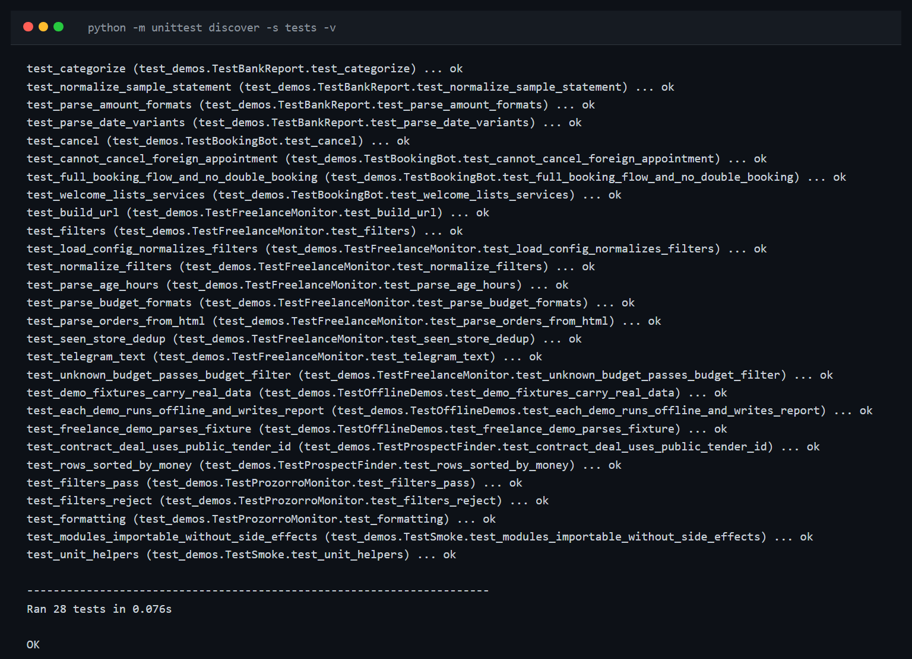

# freelance-automation-demos

П'ять невеликих інструментів на Python, які я написав самостійно: монітор тендерів, звіт із банківської виписки, Telegram-бот запису на послуги, пошук компаній для холодних контактів і монітор нових замовлень на freelance.ua зі сповіщеннями в Telegram.

Тільки стандартна бібліотека Python 3.9+ — жодних сторонніх залежностей, ключів API чи платних сервісів. Два монітори читають відкриті сторінки в мережі, решта працює офлайн. Усі п’ять запускаються без мережі: три мережеві скрипти мають режим `--demo` на збережених відповідях.

## Скріншоти

HTML-звіт монітора замовлень — справжній запуск: зібрано 30 замовлень із трьох сторінок, 6 пройшли фільтри.



Тести — 28 перевірок без мережі:



## Що тут є

| Файл | Що робить | Результат |
|---|---|---|
| `prozorro_monitor.py` | Читає відкритий API Prozorro, фільтрує закупівлі за ключовими словами, кодом ДК 021, сумою й регіоном, прибирає дублі | CSV, HTML-звіт, сповіщення в Telegram |
| `bank_report.py` | Розбирає CSV-виписку банку, групує транзакції за категоріями, рахує підсумки | `summary.txt`, `report.csv`, `report.html` |
| `booking_bot.py` | Telegram-бот запису на послуги: вільні слоти, підтвердження, скасування клієнтом, захист від подвійного запису | записи в SQLite + адмін-список |
| `prospect_finder.py` | Бере переможців закупівель Prozorro, агрегує по компаніях суми й кількість перемог | `prospects.csv`, `prospects.html` |
| `freelance_monitor.py` | Читає останні сторінки списку замовлень freelance.ua і фільтрує локально — за ключовими словами, бюджетом і свіжістю; прибирає дублі | CSV, HTML-звіт, сповіщення в Telegram |

## Швидкий старт

```bash
git clone <this repo>
cd freelance-automation-demos

# 1. Звіт по виписці
python bank_report.py sample_statement.csv
#    -> out/summary.txt, out/report.csv, out/report.html

# 2. Бот запису — повний діалог без токена
python booking_bot.py --demo

# 3. Монітор тендерів (живий API, без ключа)
python prozorro_monitor.py -k ремонт --inspect 60 --csv out/tenders.csv --html out/tenders.html
python prozorro_monitor.py --config config.example.json --inspect 100

# 4. Пошук компаній серед переможців тендерів
python prospect_finder.py --days 21 --limit 200 --min-amount 100000 --top 40
#    -> out/prospects.csv + out/prospects.html

# 5. Монітор нових замовлень freelance.ua
python freelance_monitor.py --config freelance_config.example.json --csv out/orders.csv --html out/orders.html
python freelance_monitor.py -k python -k "телеграм бот" --min-budget 900 --pages 3 --all
python freelance_monitor.py --loop 600 --telegram   # перевіряти кожні 10 хв
```

Реальний Telegram:

```bash
export TELEGRAM_BOT_TOKEN=123456:ABC...   # токен від @BotFather
export ADMIN_CHAT_ID=123456789            # куди слати нові записи
python booking_bot.py
```

Для обох моніторів — ті самі `TELEGRAM_BOT_TOKEN` і `TELEGRAM_CHAT_ID` плюс прапорець `--telegram`: кожне нове замовлення приходить окремим повідомленням із назвою, бюджетом, кількістю пропозицій і посиланням.

## Демо без мережі

Три скрипти, які типово ходять у мережу, мають `--demo`: вони читають збережені відповіді з `fixtures/` і проходять той самий шлях — розбір, фільтри, звіт. Нічого не завантажується й нічого не надсилається.

```bash
python freelance_monitor.py --demo --all --html out/demo/orders.html
python prozorro_monitor.py --demo --all --csv out/demo/tenders.csv --html out/demo/tenders.html
python prospect_finder.py --demo --out out/demo/prospects
```

Фікстури — це реальні відповіді: одна сторінка списку замовлень freelance.ua (10 карток), 6 найновіших тендерів і 8 підписаних договорів з відкритого API Prozorro. Фільтри, дедуплікація і звіти працюють так само, як у живому прогоні; у демо-режимі Telegram не надсилається. `bank_report.py` офлайновий без прапорця (читає `sample_statement.csv`), `booking_bot.py --demo` — повний діалог запису без токена.

## Тести

```bash
python -m unittest discover -s tests -v
```

28 тестів, без мережі: тести демо-режиму окремо перевіряють, що кожен `--demo` відпрацьовує і пише звіт при підміненому `urlopen`, який кидає помилку: розбір сум і категорій виписки, логіка запису (включно з відмовою у подвійному записі та спробою скасувати чужий запис), фільтри тендерів, розбір HTML-сторінки замовлень freelance.ua на фікстурі, фільтри за бюджетом/свіжістю/словами, дедуплікація в SQLite, текст сповіщення, нормалізація контрактів і сортування списку компаній.

## Структура

```
bank_report.py          звіт із виписки
booking_bot.py          Telegram-бот запису
prozorro_monitor.py     монітор закупівель
prospect_finder.py      пошук компаній для контактів
freelance_monitor.py    монітор замовлень freelance.ua
category_rules.json     правила категорій для звіту
config.example.json     приклад конфігурації монітора Prozorro
freelance_config.example.json  приклад фільтрів для freelance.ua
sample_statement.csv    тестова виписка
fixtures/               збережені відповіді для --demo (офлайн)
tests/test_demos.py     тести
out/                    результати запусків
portfolio/              скріншоти для портфоліо
```

## Обмеження (чесно)

- `prozorro_monitor.py` за один прогін переглядає найновіші `--inspect` карток (типово 100). Для повного покриття потрібен глибший обхід фіду або офіційний OCDS-датасет.
- `booking_bot.py` тримає стан діалогу в памʼяті процесу, записи — в SQLite. Для кількох майстрів чи філій потрібна окрема таблиця послуг-виконавців.
- `bank_report.py` категоризує за ключовими словами, а не «розуміє» опис транзакції: для чистих результатів треба доповнити `category_rules.json` своїми мерчантами.
- Контакти компаній Prozorro не публікує — `prospect_finder.py` дає назву, ЄДРПОУ й суми, а сайт/телефон треба знайти окремо.
- `freelance_monitor.py` читає тільки відкритий список замовлень (пошук на сайті не використовується — фільтрація повністю локальна) і не робить ставок: подача пропозицій на freelance.ua потребує входу в акаунт, тому це робить людина. Скрипт лише знаходить замовлення й одразу надсилає їх у Telegram, щоб ставку можна було зробити першою.
- Глибина пошуку обмежена `--pages` (типово 1 сторінка = 10 замовлень): скрипт дивиться найновіші, а не весь архів на 180+ замовлень.
- Замовлення без вказаної ціни («Договірна») **не** відсікаються фільтром бюджету: ціна невідома, а не низька, тому такі замовлення потрапляють у звіт завжди, якщо проходять за словами й свіжістю. Якщо потрібні тільки замовлення з ціною — це треба додати окремим флагом.
- Розмітка freelance.ua може змінитися — тоді треба поправити регулярні вирази в `parse_orders()` (тести на фікстурі покажуть, що саме зламалося).
